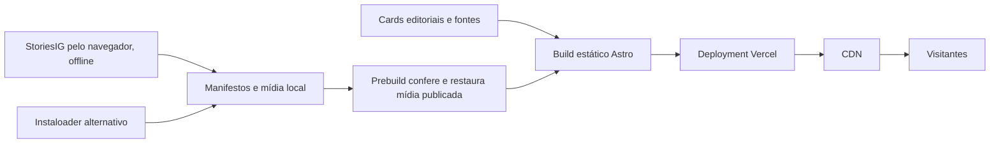

# Operação e escala

Este projeto distribui páginas estáticas por CDN e possui imagens e Reels realmente importados. Atendimento a milhões de pessoas depende também do volume de mídia, do pico de tráfego e das condições do plano de hospedagem. A equipe Vercel utilizada foi verificada como **Hobby**; nenhum upgrade pago ou contrato de capacidade foi provisionado. Build e testes funcionais passaram, mas não houve teste de carga que comprove capacidade para milhões.

## Arquitetura atual

[Astro 7](../package.json) gera saída `static` em `dist/`, conforme [astro.config.mjs](../astro.config.mjs). [vercel.json](../vercel.json) define o build, a pasta publicada e os headers. O caminho do visitante não executa scraper, consulta ao Instagram ou geração de página no servidor.



Os coletores leem os 15 perfis de [sources.json](../src/data/sources.json) e preservam registros anteriores. A coleta principal usa [scrape-storiesig.mjs](../scripts/scrape-storiesig.mjs) e escreve [storiesig-posts.json](../src/data/storiesig-posts.json). A alternativa direta [scrape-instagram.py](../scripts/scrape-instagram.py) escreve [instagram-posts.json](../src/data/instagram-posts.json). A primeira tentativa direta com Instaloader exigiu autenticação e importou zero registros; isso não indica que os perfis estejam vazios. O fluxo público StoriesIG conseguiu importar arquivos reais; a cobertura das fontes deve ser conferida no relatório, sem presumir sucesso nos 15 perfis.

As mídias públicas ficam em `public/media/instagram/`. O StoriesIG arquiva originais em `.cache/storiesig/originals/` e usa FFmpeg para criar MP4 menores e capas, removendo metadados da cópia processada. Os cards próprios usam PNG para download e WebP para apresentação em `public/cards/`. Arquivos em `public/` entram no build e são públicos.

`publishedAt` permanece `null` quando a data original não está disponível; `observedAt` registra a coleta e não a publicação. Horários relativos podem ser preservados como `publishedLabel`. Sem permalink verificável, `permalink` fica `null` e a fonte aponta para o perfil ou sua aba de Reels. Não reconstrua datas ou URLs de postagem a partir de aproximações.

Mídias importadas, cache e relatórios são ignorados pelo Git. O passo `prebuild` executa [restore-media.mjs](../scripts/restore-media.mjs): confere arquivos locais não vazios e restaura os que faltam a partir de URLs públicas no deployment indicado por `PUBLIC_SITE_URL`. A restauração verifica tipo de mídia e limite de tamanho e interrompe o build se uma mídia necessária não estiver disponível. Ela não coleta novas postagens.

Novos arquivos devem ser publicados primeiro pela cópia local que contém os downloads. Depois disso, uma cópia limpa do GitHub pode recuperar essas URLs já publicadas durante o prebuild. Esse bootstrap depende do deployment existente: um arquivo inédito não pode ser restaurado antes de sua primeira publicação. Não envie cache, originais, sessões ou configurações autenticadas para resolver essa diferença.

A Vercel documenta cache automático de arquivos estáticos em sua rede. Cache reduz trabalho na origem; requisições e bytes entregues aos visitantes continuam contabilizados. [Cache do CDN](https://vercel.com/docs/caching/cdn-cache), [métricas de uso](https://vercel.com/docs/manage-cdn-usage).

## Política de cache

| Caminho | Header configurado no projeto | Operação |
| --- | --- | --- |
| `/_astro/` | Um ano, `immutable` | Bundles com nome gerado no build |
| `/fonts/` | Um ano, `immutable` | Renomear a URL ao alterar a fonte |
| `/images/`, `/cards/`, `/media/` | Um dia e sete dias de `stale-while-revalidate` | Uma alteração pode demorar a aparecer em caches do navegador |

Ao substituir uma peça importante, publique uma nova URL com versão ou hash e atualize o manifesto. Confirme os headers reais no deployment; configuração no repositório e resposta publicada são evidências distintas.

## Antes de um acervo grande

Mova vídeos e originais pesados para armazenamento de objetos com CDN destinado a mídia. O site estático pode continuar na Vercel; o build deverá receber um manifesto público com URLs permanentes de mídia. Nunca publique URLs assinadas com credenciais como endereço de download do acervo.

Essa migração requer adaptar a validação do scraper: hoje seu contrato só aceita URLs locais em `/media/instagram/`. Introduzir URLs remotas exige allowlist explícita do domínio próprio, preservação de autoria/permalink e testes dessa validação. Também será preciso ajustar `connect-src` da CSP caso o player faça requisições HLS a outro domínio.

O coletor já gera MP4 menores e thumbnails com FFmpeg. Para um acervo grande, evolua para HLS com diferentes bitrates e configure CORS e suporte a intervalos de bytes. Carregue vídeo após interação e preserve a imagem de capa na listagem. HLS, fila de transcodificação, armazenamento remoto e CDN de mídia não estão provisionados atualmente. Para dezenas de milhares de registros, limite o tamanho das páginas de galeria com paginação e separe o índice de busca; a duração do build e o peso do HTML também devem ser medidos.

## Orçamento de tráfego: exemplo, não medição

Hipóteses: 1 milhão de visitas, uma página por visita, transferência média de 600 KB para HTML/CSS/JS/fontes/imagens, dez requisições ao CDN por visita; 20% assistem a um vídeo de 5 MB e 10% baixam um card de 300 KB. Unidades decimais, sem desconto presumido de cache no navegador.

| Componente | Cálculo | Transferência estimada |
| --- | --- | --- |
| Página e assets | `1.000.000 × 600 KB` | 600 GB |
| Vídeos | `200.000 × 5 MB` | 1.000 GB |
| Cards baixados | `100.000 × 300 KB` | 30 GB |
| Total | Soma | 1,63 TB |

As páginas sozinhas representam aproximadamente 10 milhões de requisições. Vídeos, downloads, bots, navegação adicional, manifests e segmentos HLS aumentam esse número. Multiplique as hipóteses pelo público esperado e acrescente margem operacional. Esses valores não são tamanho medido do site, previsão de fatura ou garantia de plano.

Para dimensionar pico, 1 milhão de visitas distribuídas em 24 horas é diferente de 1 milhão em dez minutos: o segundo caso significa aproximadamente 1.667 novas visitas por segundo antes de contar assets. A capacidade contratada e a validação devem cobrir o pico relevante.

## Planos e limites Vercel

Fontes oficiais consultadas em 14 de outubro de 2026. O plano efetivo verificado nesta implantação é Hobby. O repositório não publica dados de billing nem configura credenciais da conta. Consulte produtos habilitados e saldo no painel antes de divulgação ampla.

| Item documentado | Hobby | Pro |
| --- | --- | --- |
| Fast Data Transfer mensal | 100 GB incluídos | Tier inicial Flat Rate CDN: 1 TB |
| CDN Requests mensais | 1 milhão incluído | Tier inicial Flat Rate CDN: 1 milhão |
| Upload de arquivos fonte pelo CLI | 100 MB | 1 GB |

Hobby destina-se a uso pessoal não comercial. Ao ultrapassar suas quotas, recursos podem ficar indisponíveis até o período de recuperação descrito pela Vercel. O exemplo acima ultrapassa as quotas básicas de requisições de ambos os planos. [Hobby](https://vercel.com/docs/plans/hobby), [Pro](https://vercel.com/docs/plans/pro-plan), [limites de upload](https://vercel.com/docs/limits#static-file-uploads).

Flat Rate CDN é configurável no Pro e possui tiers de capacidade. Uso mensal acima do tier pode mover a equipe para um tier superior no ciclo seguinte. A documentação exclui distribuição em massa de arquivos e entrega de mídia em grande escala quando ela domina a banda; portanto, um tier Pro não é garantia geral para um portal de downloads de vídeos. [Capacidade e elegibilidade](https://vercel.com/docs/pricing/flat-rate-cdn).

Preços dependem de produto, modalidade e região; não há estimativa de custo contratada neste documento. Monitore **Usage**, **Billing**, **CDN Requests** e **Fast Data Transfer** no [painel Vercel](https://vercel.com/dashboard). Defina notificações de gasto quando disponíveis, revise uso de bots e confirme a elegibilidade do workload com a hospedagem antes da campanha de tráfego.

## Coleta e publicação

Use Node compatível com [package.json](../package.json), Chrome e FFmpeg disponíveis na máquina de coleta. O fluxo principal entra no [StoriesIG público](https://storiesig.info/pt7IJ/), preenche o formulário, seleciona posts/Reels e usa os downloads normais do navegador. A API comercial do serviço não é utilizada; não é necessária chave dessa API nem autenticação no Instagram.

```sh
npm ci
npm run scrape:storiesig
npm run build
npm run preview
```

O código atual limita a uma postagem e um Reel por perfil por padrão, aguarda cinco segundos entre fontes e permite selecionar um perfil:

```sh
npm run scrape:storiesig -- --source lulaoficial
```

O manifesto deduplica arquivos processados por hash. O relatório `data/storiesig-import-report.json` registra `sources`, `status`, contagens e bytes públicos; o feed e o relatório são persistidos atomicamente após importações e fontes. Confira os estados `ok`, `preserved`, `media_unavailable`, `media_budget` e `public_flow_unavailable`. Os estados de restrição ou challenge interrompem a coleta das próximas fontes, registradas como `not_attempted`. Não há repetição automática de bloqueios nem resolução de desafios. O serviço e seu fluxo público podem mudar ou ficar indisponíveis.

A distribuição acumulada em `public/media/instagram/` tem uma guarda de **85 MiB**. O coletor StoriesIG considera arquivos públicos existentes e só copia a nova mídia com sua capa se couber no orçamento. FFmpeg busca cópias de vídeo menores, com reprodução progressiva por `faststart`; o tamanho efetivo continua sendo verificado. Originais e temporários em `.cache/` ficam fora desse orçamento e do deployment. O limite não garante que todo o conjunto de arquivos fonte enviado pelo CLI fique abaixo dos 100 MB do Hobby: confira também código, cards, fontes e demais assets.

A alternativa direta mantém o ambiente Python restrito ao repositório:

```sh
python3 -m venv .venv
.venv/bin/python -m pip install -r requirements-scraper.txt
npm run scrape:instagram
```

Instaloader tenta cinco posts e cinco Reels por perfil por padrão, sem login, sessão ou proxies. Aguarda oito segundos entre perfis e, diante de 429, repete uma única vez após trinta segundos. Um novo 429 ou exigência de autenticação interrompe as fontes seguintes. O relatório `data/instagram-import-report.json` registra `profiles`, `status` e `importedCount`. O programa retorna 0 para fontes bem-sucedidas, 1 para coleta parcial/restrita e 2 para erro de configuração/dependência. Não automatize repetição infinita após 401, 403 ou 429.

Os limites próprios do Instaloader são 80 MiB por arquivo e 250 MiB copiados por execução; diferem da guarda acumulada StoriesIG e podem exceder a capacidade de upload Hobby. Para uma coleta direta pequena:

```sh
npm run scrape:instagram -- --max-posts 2 --max-reels 1 --max-file-mb 20 --max-total-mb 50
```

Confira o tamanho de `dist/`, da saída Vercel e do conjunto enviado pelo CLI após qualquer coleta. Migre a mídia antes de ultrapassar limites de deployment ou de tráfego.

O build não coleta postagens. Atualize o feed offline, revise origem e direitos de uso do material, execute o build e publique o artefato. A republicação de conteúdo disponível ao público continua exigindo uma fonte e autorização adequadas ao material; registre remoções/correções no acervo e publique novo deployment quando necessário.

Para incorporar as mídias locais ignoradas pelo Git, gere e publique a saída de produção a partir dessa mesma cópia:

```sh
npx vercel@64.0.2 build --prod
.git/tools/gitleaks dir --redact --no-banner .vercel/output/static
npx vercel@64.0.2 deploy --prebuilt --prod --yes
```

O build de produção deve ocorrer após o término da coleta. Publique apenas a saída destinada ao site; `.vercel/`, `.env.local` e configurações locais continuam ignorados. Faça a primeira publicação dos arquivos novos antes de depender da restauração em um build limpo do Git.

## Validação e segurança operacional

Os comandos de verificação do projeto são:

```sh
python3 -m unittest discover -s scripts -p 'test_*.py'
npm run build
npm test
```

Neste ciclo, o build estático foi executado com sucesso, **36 testes Playwright desktop/mobile** passaram e **12 testes offline do coletor direto** passaram. A suíte de navegador verifica galerias, busca, compartilhamento canônico, PNG, foco, fontes e preferências de acessibilidade; também verificou ausência de requisições externas iniciais e erros JavaScript. Os testes de compartilhamento interceptam a chamada nativa para conferir os bytes reais do MP4/PNG, ausência de URL no envio do arquivo, download alternativo, cancelamento, recuperação de falhas e preparo lento com um novo toque. Eles não executam o envio dentro do aplicativo WhatsApp. Os testes Python exercitam contrato, sanitização, deduplicação e backoff sem acessar Instagram. Essas verificações não comprovam sucesso de coleta em todas as fontes, disponibilidade contínua do StoriesIG ou capacidade sob carga. Este documento não registra teste de carga para milhões.

Antes da divulgação para milhões, registre tamanho transferido em dispositivo móvel, headers/cache reais, funcionamento dos downloads, latência e erro em mais de uma região. Faça uma rampa de carga controlada no próprio deployment, com orçamento de teste definido; interrompa ao observar degradação ou gasto inesperado. Acompanhe consumo de CDN e mantenha o último deployment válido disponível para rollback.

O repositório é público. Nunca inclua chaves, tokens, senhas, certificados privados, sessões ou valores de ambiente em código, docs, logs e commits. Variáveis `PUBLIC_*` são públicas; `PUBLIC_SITE_URL` serve apenas para o endereço canônico. Segredos de serviços futuros devem ficar em variáveis privadas do ambiente de operação e arquivos ignorados. O scraper publica links canônicos sem query/fragmento e descarta saída bruta da biblioteca que poderia conter URLs assinadas.

Mantenha `core.hooksPath=.githooks`. Revise os arquivos escolhidos antes de commit/push e execute os scanners locais com redação:

```sh
git diff --cached --stat
.git/tools/gitleaks git --pre-commit --staged --redact --no-banner --ignore-gitleaks-allow .
.git/tools/gitleaks git --log-opts=--all --redact --no-banner --ignore-gitleaks-allow .
.git/tools/gitleaks dir --redact --no-banner dist
```

Se houver detecção, interrompa o envio e remova o segredo de todos os commits que seriam publicados. Não desative hooks ou a verificação. O scan de `dist/` cobre o conteúdo público de deploy, inclusive mídia e feed locais não versionados; ele complementa a revisão dos arquivos.
